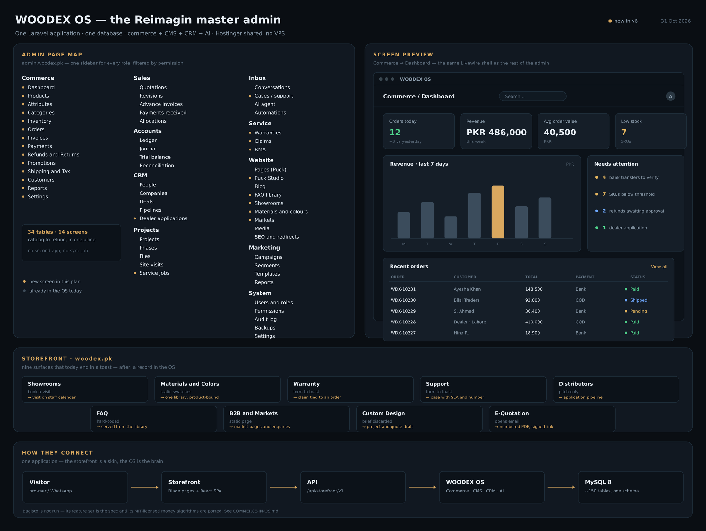
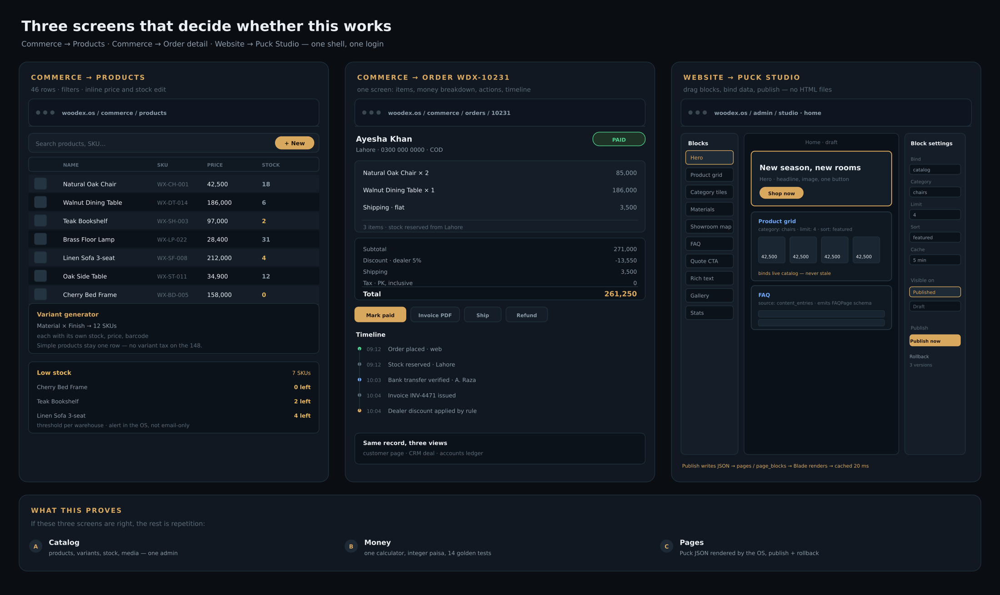
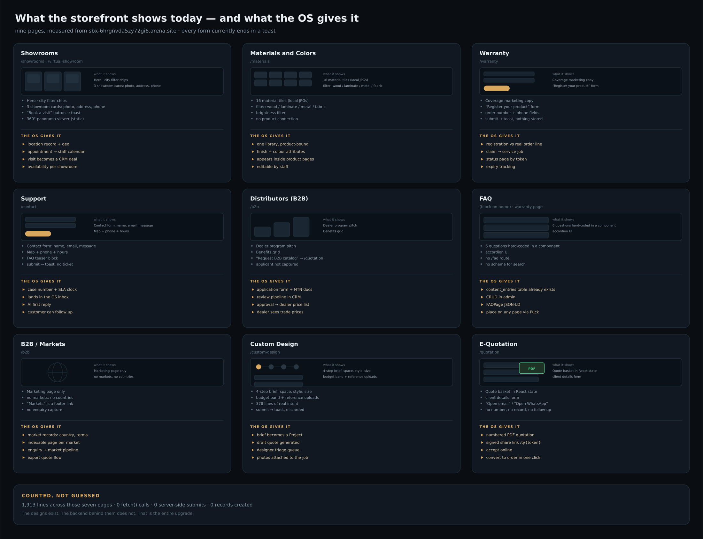

# Admin Map & Quick Tasks

Three pictures, no prose. Measured from the OS clone (`c437cad`) and the live storefront
(`sbx-6hrgnvda5zy72gi6.arena.site`).

---

## 1. The admin page map

One sidebar. Every dot marked **orange** is a screen this plan adds. Everything unmarked already exists in the OS
today (Sales, Accounts, CRM, Projects, Inbox, Marketing, System).

**New commerce screens (14):** Dashboard · Products · Attributes · Categories · Inventory · Orders · Invoices ·
Payments · Refunds & Returns · Promotions · Shipping & Tax · Customers · Reports · Settings.

**New elsewhere (10):** Cases/Support · Warranties · Claims · RMA · Puck Studio · FAQ library · Showrooms ·
Materials & colours · Markets · Dealer applications · Service jobs.

---

## 2. The three screens that decide whether it works

| Screen | Why it is the one to get right |
|---|---|
| **Products** | If the catalog grid is slow or awkward, staff stop using it and every price becomes a ticket |
| **Order detail** | Items, money breakdown, actions and timeline on one page — the whole money story visible at once |
| **Puck Studio** | Blocks on the left, live page in the middle, bindings on the right. Publish writes JSON, not files |

---

## 3. What the storefront shows today vs. what the OS gives it

Nine surfaces, all currently ending in a toast. The right half of each card is the deliverable.

---

## 4. Quick tasks — first six weeks

Ordered. Each row is one shippable thing, not a phase.

| # | Task | Owner | Days | Done when | Status |
|---|---|---|---|---|---|
| **T1** | `Money` value object + `CartCalculator` skeleton | A | 2 | Integer paisa everywhere, no float in the path | ✅ **done** |
| **T2** | 14 golden total fixtures + sum-invariant property test | A | 2 | Tests run red, then green | ✅ **done** — 16 tests / 13,371 assertions |
| **T3** | Commerce catalog tables (13) + factories + seeder | A | 3 | `migrate:fresh --seed` → 20 products, 4 categories | ✅ **done** — WX-1001…WX-1020 |
| **T4** | Admin shell: Commerce group, empty screens, permissions | B | 2 | Sidebar shows 14 screens, unauthorized users blocked | ✅ **done** |
| **T5** | Products admin: list, filter, search, inline price/stock | B | 4 | Staff edit a price without a developer | ✅ **done** |
| **T6** | Media pipeline: upload → 3 sizes + WebP, outside web root | B | 2 | One image end-to-end, served with cache headers | ✅ **done** |
| **T7** | `GET /products`, `/products/{slug}`, `/categories` | B | 2 | Cached 5 min, typed client generated | ✅ **done** |
| **T8** | Puck Studio behind the OS session (`/admin/website/pages/{page}/edit`) | C | 3 | Editor opens, drag-drop, saves JSON | ✅ **done** |
| **T9** | Registry v1: 8 blocks, editor + Blade renderer, parity test | C | 4 | Same JSON → same HTML, CI fails on drift | ✅ **done** — 8 blocks / 8 views |
| **T10** | Serve `pages` at `/p/{slug}`, cached, drafts via `preview_token` | C | 3 | A page created in Studio renders on the site | ✅ **done** |
| **T11** | **Vertical slice: product → cart → COD order → invoice** | A+B | 5 | A real order exists in the DB with correct totals | ✅ **done** — 14 tables, `commerce:demo-order`, order screens |
| **T12** | Load probe: 30 concurrent catalog + 5 checkouts | A | 2 | p95 < 1.5 s, zero 5xx, zero oversell | ✅ **done** — `commerce:load-probe`, verdict + JSON report |
| **T13** | Storefront reads the catalog API instead of `products.ts` | B | 3 | Shop, product, series and quotation pages render data from `/api/storefront/v1` | ✅ **done** — API client + adapter, snapshot fallback, `ProductDetail` payload |

**Built:** `platform/app/Domain/Commerce/` (Money, CartLine, DiscountRule, ShippingMethod, CartInput, LineTotal, CartTotals, CartCalculator) + 14 fixtures + runner. Run it with `php platform/tests/run.php`.

**Built:** T1–T13. The code gate is closed; what remains is running the probe on staging and recording the numbers (see `HOSTINGER-CAPACITY.md` §Gate G1). **Week 1:** T1–T4 ✅. **Week 2:** T5–T7 ✅. **Week 3:** T8–T10 ✅. **Week 4:** T11 ✅ · T12 ✅ · T13 ✅.

**T1–T13 are code, not a document.** They live in `platform/` (plus `src/lib/api/` for the storefront) and pass: 204 checks, 15,330 assertions, 1,000 generated carts.

After T12 passes on staging, the remaining work is repetition: 30 more tables, 10 more screens, 18 more blocks, 9 surfaces. The storefront now has one real dependency on the OS — the catalog API — and every other page still reads the bundled snapshot until its own API exists.

---

## 5. What is deliberately not on this list yet

Checkout UI polish · promotions · RMA depth · multi-currency · AI agent tools · the 142-page migration.
All of it is specified in `MASTER-PLAN.md` §3 and comes after the vertical slice proves the money path.
