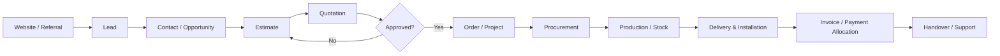

# 01 — WOODEX 2030 Master Product Requirements Document

**Status:** Planning baseline  
**Product name:** WOODEX Agency OS  
**Primary business:** WOODEX furniture business  
**Audience:** Owner, product/design, engineering, operations, QA and AI implementation agents

## 1. Product vision

WOODEX Agency OS is one connected operating system for managing the customer journey and the internal work required to deliver furniture products and services. It connects the public storefront to customer acquisition, CRM, estimation, quotation, order management, procurement, production, inventory, delivery, projects, finance, support, marketing and automation.

The product must feel like one coherent platform. Users should not need to understand which legacy application originally owned a feature.

## 2. Outcomes

1. Give customers a clear, fast and trustworthy furniture storefront.
2. Give staff one role-aware dashboard for daily work.
3. Connect leads, estimates, quotations, invoices, payments, orders and projects through traceable records.
4. Make commerce and operational work visible from enquiry to fulfilment.
5. Give authorized staff a visual page builder without requiring code edits for routine content changes.
6. Establish a maintainable Laravel business backend and MySQL production data store.
7. Make the system usable on Hostinger Shared Hosting within verified resource constraints.
8. Reduce duplicated modules, inconsistent navigation and unreliable AI-assisted implementation.

## 3. Product principles

- **One business record, one authority:** a business object has one canonical owner and one production write authority.
- **Workflow before menu:** navigation should reflect how people work, not the history of code modules.
- **Progressive disclosure:** show available, useful destinations; do not fill the sidebar with nonfunctional “Soon” and “Legacy” links.
- **Data-backed UI:** no fake metrics or success states.
- **Permission by action:** viewing, creating, editing, approving, publishing, exporting and administering are separate capabilities.
- **Recoverability:** important changes are versioned or auditable; destructive actions require safeguards.
- **Mobile-aware:** all core screens work at narrow widths, even if dense data entry is optimized for desktop.
- **No Interior carryover:** exclude Woodex Interior-specific branding, content, media, customer records, pricing data and workflows.
- **Incremental migration:** preserve the running application while replacing modules in controlled steps.

## 4. Users and roles

The exact role list is configurable. Initial role archetypes:

| Role archetype | Primary responsibilities |
|---|---|
| Owner / Super Admin | Organization settings, access, approvals, reporting and platform oversight |
| Operations Manager | Projects, production, delivery, stock and operational exceptions |
| Sales Manager | Leads, estimates, quotations, customer communication and sales reporting |
| Sales Executive | Assigned leads, contacts, estimates and quotation preparation |
| Accounts Manager | Invoices, payment records, ledger, payables and financial reporting |
| Procurement Officer | Suppliers, purchase orders, receipts and supplier invoices |
| Production Manager | Production jobs, stages, material consumption and completion |
| Warehouse Staff | Receipts, stock movement, reservations and dispatch preparation |
| Website Editor | Pages, content, media, SEO and draft previews |
| Website Publisher | Approval and publication rights |
| Support Agent | Conversations, warranty cases and customer follow-up |
| Client Portal User | Own approved portal records only |

Roles are permission bundles, not hardcoded identity types. A user can receive additional scoped permissions when authorized.

## 5. Product surfaces

### 5.1 Public React storefront

- Homepage and campaign landing pages.
- Product, category and series discovery.
- Product detail pages and variant selection where applicable.
- Search, filtering and comparison only where supported by catalogue data.
- Quote request and contact journeys.
- Cart/checkout/order journey if commerce payment and fulfilment policy is confirmed.
- Delivery/installation information.
- Support and warranty entry points.
- Blog, portfolio and informational content.
- SEO metadata, canonical URLs, redirects and structured content.

### 5.2 React dashboard

- One application shell.
- Permission-aware sidebar and global search.
- Business overview dashboard.
- CRM, sales, commerce, operations, procurement, accounts, projects, inbox, automation, marketing, Website Studio and system administration.
- Standard list, detail, create, edit, approval and reporting patterns.

### 5.3 Laravel backend

- Authentication and API authorization.
- Business rules and validation.
- Canonical business records.
- Approval and audit history.
- API contracts.
- CMS content and publication state.
- Background work and scheduled tasks.
- Integrations and webhooks.
- Data export and operational reporting.

### 5.4 Website Studio / Puck

- Puck-based visual composition for approved page components.
- Drafts, revisions, previews, approvals and publishing.
- Header, footer and mega-menu composition.
- Reusable sections and templates.
- Global design tokens.
- Shared media library and SEO settings.
- Commerce components read catalogue data; they do not own catalogue records.

## 6. Scope

### 6.1 In scope

- Unified dashboard and navigation redesign.
- Storefront UX reimagination.
- Reuse and cleanup of generic Laravel modules.
- Laravel API layer for React applications.
- MySQL target schema and controlled data migration.
- CRM and sales lifecycle.
- Commerce catalogue and order workflows.
- Procurement, inventory and production workflows.
- Accounts and manual payment recording, subject to final payment policy.
- Projects, vendors, client portal and handovers.
- Inbox, automation, WhatsApp/Telegram integrations where credentials/provider access are supplied.
- Marketing and content.
- Puck Website Studio.
- Access control, audit, reports, QA, deployment and operations.

### 6.2 Out of scope unless separately approved

- Reusing Woodex Interior brand assets, pages, media, project history or customer data.
- Replacing React with a different frontend framework.
- Running two permanent admin dashboards.
- A generic multi-tenant SaaS product for unrelated businesses.
- Unrestricted arbitrary HTML/JavaScript/PHP inside the page builder.
- Autonomous financial transactions or external messaging without approval and audit.
- Production cutover before rehearsal and owner sign-off.

## 7. Functional requirements by domain

### CRM
- Create, assign, qualify, update and close leads.
- Convert qualified leads into contacts/opportunities without losing history.
- Track source, campaign, owner, status, next action and follow-up dates.
- Record calls, notes, visits, tasks and communication events.
- Prevent duplicate records through configurable matching and merge review.

### Sales
- Prepare estimates from reusable line items and pricing rules.
- Generate quotations with revisions, validity, taxes and approval status.
- Support role-based quote approval.
- Convert approved quotations into invoices or orders according to workflow policy.
- Track invoice status, due dates, payment allocations and outstanding balance.
- Generate downloadable customer documents.

### Commerce
- Manage products, categories, series, variants, media, pricing and publication status.
- Manage customer orders and order lines.
- Track order fulfilment state and exceptions.
- Separate catalogue presentation from catalogue data ownership.
- Support delivery and installation milestones where the workflow is enabled.

### Procurement and production
- Manage suppliers and supplier terms.
- Create purchase orders and goods receipts.
- Record supplier invoices and matching exceptions.
- Maintain warehouse stock ledger and stock balances.
- Track transfers, reservations and adjustments.
- Create production jobs with stages, material requirements and completion evidence.

### Accounts
- Record income, expenses, payables and payment allocations.
- Provide ledger and reports based on approved accounting rules.
- Keep manual payment recording distinct from payment gateway integration.
- Prevent silent edits to posted financial records; use reversal/adjustment entries and audit.

### Projects
- Create projects from approved work.
- Track milestones, tasks, owners, budgets, vendors, costs and handovers.
- Provide a client portal with strict per-client data scoping.
- Track change requests and approval history.

### Inbox and automation
- Centralize supported communication channels.
- Associate conversations with leads, contacts, orders or projects.
- Support templates and sequences with consent, opt-out and delivery status.
- Provide retry, failure logs and human handoff.
- Do not send messages automatically until the relevant workflow is approved and tested.

### Website Studio
- Edit page composition with approved components.
- Preview responsive breakpoints.
- Manage reusable sections and templates.
- Manage navigation, theme, media, SEO, redirects and publishing.
- Keep draft preview private and publication versioned.

## 8. Non-functional requirements

| Area | Requirement |
|---|---|
| Security | Server-side authorization on every protected action; secure session handling; audit trail |
| Performance | Optimize for shared-hosting resource limits; paginate and index high-volume lists |
| Availability | Graceful errors, backup/restore procedures and recoverable releases |
| Accessibility | Keyboard access, focus visibility, labels, contrast and semantic controls |
| Responsive | Core dashboard and storefront usable on desktop, tablet and mobile |
| Maintainability | Modular Laravel domain boundaries; reusable React components; typed API contracts |
| Observability | Structured logs, request IDs, failed-job visibility and health checks |
| SEO | Stable URLs, metadata, canonical URLs, redirects, sitemap and crawlable published content |
| Data integrity | Foreign keys where appropriate, transactions, unique constraints and reconciliation |
| Portability | Documented deployment and backup procedures; avoid unnecessary host-specific coupling |

## 9. Core business lifecycle

This is the target lifecycle. Not every order will use every stage; workflow configuration must support product-only and service/project cases.

## 10. Success metrics

Instrument baselines before setting numeric targets.

- Lead response time.
- Lead-to-quotation conversion.
- Quotation approval rate.
- Average quotation turnaround.
- Order fulfilment lead time.
- On-time delivery/installation rate.
- Stock accuracy and stockout frequency.
- Invoice collection and overdue aging.
- Project budget variance and milestone reliability.
- Website enquiry conversion.
- Page-builder publish cycle time.
- Workflow failure and retry rate.
- User task completion time and support incidents.

## 11. Assumptions requiring confirmation

- Currency is likely PKR; confirm before financial implementation.
- Tax is expected to be configurable; confirm tax types, inclusive/exclusive behavior and invoice requirements.
- Payment recording is expected to be manual initially; confirm whether online gateway checkout is required.
- Client portal is included in the target scope; confirm customer access and approval model.
- Quote approval is role-based; define thresholds and authorized roles.
- Product variant, discount, delivery, installation and warranty rules require owner validation.
- Branches/warehouses and multi-location operations need confirmation.
- Exact Hostinger plan, PHP version/extensions, cron cadence, database limits and SSH/Composer access remain unverified.

## 12. Release acceptance

A release is acceptable only when:
- Every delivered workflow has an approved requirement and tested path.
- No feature is represented as available if it is only a placeholder.
- Business records have one production write authority.
- Role checks are tested at API level.
- Data migration reconciles source and destination records.
- Backups and restore are rehearsed.
- Core storefront and dashboard journeys pass browser tests.
- Owner approves staging evidence before production cutover.
