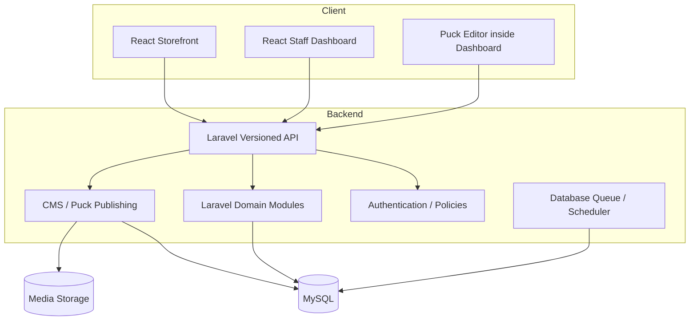

# 02 — WOODEX 2030 System Architecture

## 1. Architecture decision summary

| Layer | Target |
|---|---|
| Public storefront | Existing React application, redesigned |
| Staff dashboard | Existing React application, redesigned |
| Visual page editor | Puck embedded in React Website Studio |
| Business backend | Laravel |
| Production database | MySQL on Hostinger |
| Static assets | Built React assets and controlled media storage |
| Scheduled work | Laravel scheduler invoked by Hostinger cron, subject to plan limits |
| Queue | Database-backed queue first; cron-driven worker strategy subject to hosting support |
| API | Versioned JSON REST API |
| Authentication | Laravel-managed session/token strategy selected after same-domain topology review |

## 2. Current versus target state

### Verified current-state evidence from repository inspection

- Existing storefront and dashboard are separate React applications.
- Storefront package uses React 19.2, Vite 8.2 and Tailwind 3.4.
- Dashboard package uses React 19.2, Vite 8.2 and Tailwind 4.3.
- Existing API is Express/Node.
- Existing production architecture is documented as PostgreSQL/Supabase and Vercel.
- Repository documentation reports 218 API route handlers, 25 storefront routes, 47 dashboard routes and 71 PostgreSQL tables in the audited baseline.
- A Laravel platform foundation exists under `platform/`.
- The Laravel platform has optional modules; several are disabled or incomplete.
- The authenticated dashboard was not visually accessible through the public URL; source files were inspected.

These counts are a discovery snapshot and must be revalidated before implementation.

### Target state



## 3. System boundaries

### React storefront
Owns:
- Public page rendering.
- Catalogue browsing and presentation.
- Customer-facing forms and interactions.
- Responsive rendering.
- Published Puck page rendering.
- SEO-friendly route output.

Does not own:
- Pricing authority.
- Order state transitions.
- Payment ledger.
- Stock balance authority.
- Publishing permissions.
- Approval rules.

### React dashboard
Owns:
- Staff interaction and navigation.
- Dashboard widget presentation.
- CRUD forms and list/detail views.
- Puck editor interface.
- Client-side validation for usability.

Does not own:
- Final authorization.
- Business rules.
- Financial calculations.
- Canonical data persistence.
- Publication decision.

### Laravel
Owns:
- Authentication, sessions/tokens and authorization.
- Business rules and domain validation.
- Canonical business data.
- Transaction boundaries.
- Approval workflows.
- Audit events.
- API contracts.
- Puck content, revisions and publishing.
- Queue and scheduler jobs.
- Integration credentials and webhook processing.

### MySQL
Owns persistent target production records. The exact schema and migration path are specified in document 03.

## 4. Application organization

Recommended Laravel domain organization (adapt to existing `platform/` conventions after code inspection):

```text
platform/
  app/
    Domain/
      Identity/
      CRM/
      Sales/
      Commerce/
      Procurement/
      Inventory/
      Production/
      Projects/
      Finance/
      Support/
      Inbox/
      Automation/
      Marketing/
      Website/
      Media/
      Reporting/
    Http/
      Controllers/Api/V1/
      Requests/Api/V1/
      Resources/Api/V1/
      Middleware/
    Policies/
    Jobs/
    Events/
    Listeners/
    Notifications/
    Support/
  routes/
    api.php
    web.php
  database/
    migrations/
    seeders/
```

This is a target organization, not a claim that all folders currently exist. Follow the existing Laravel app's conventions where sound; avoid a wholesale folder refactor without evidence.

## 5. Frontend organization

Target structure should retain two separately deployable React apps while sharing design tokens and component contracts:

```text
apps/
  storefront/
    src/
      app/
      routes/
      components/
      features/
        catalogue/
        product/
        quote-request/
        content/
        website-renderer/
      styles/
  dashboard/
    src/
      app/
      routes/
      components/
      features/
        dashboard/
        crm/
        sales/
        commerce/
        operations/
        procurement/
        finance/
        projects/
        inbox/
        automation/
        marketing/
        website-studio/
        system/
      styles/
  packages/ (only if current repo tooling supports a shared workspace)
    design-tokens/
    ui/
    api-client/
    contracts/
```

Do not introduce a monorepo tooling change solely to share a few CSS tokens. The simplest maintainable method must be selected after checking the existing build setup.

## 6. API and authentication topology

Preferred topology for shared hosting:
- Serve dashboard and storefront static builds from controlled paths/domains.
- Serve Laravel API under a stable same-site path or API subdomain.
- Prefer secure same-site cookies when topology supports it; otherwise use a carefully scoped token strategy.
- Set CORS, CSRF, cookie domain, secure, HttpOnly and SameSite settings deliberately.
- Never put long-lived secrets in React environment variables.
- Protect Puck draft preview endpoints and editor APIs.

Final auth approach is an implementation decision after checking domain/subdomain arrangement and Laravel auth packages already present.

## 7. Shared hosting constraints

Assume:
- No persistent Node server unless the exact plan confirms it.
- No Redis unless the exact plan confirms it.
- No WebSocket server unless the exact plan confirms it.
- Cron frequency and process execution limits may be constrained.
- CPU, memory, file count, inode, disk and database connections may be limited.

Design accordingly:
- Static React output.
- Laravel PHP request lifecycle.
- Database queue initially.
- Batch/limited scheduled work.
- Pagination and query optimization.
- Image resizing and upload limits.
- Avoid expensive synchronous integrations in web requests.

## 8. Integration boundaries

Integrations must be behind adapters/services:
- WhatsApp provider.
- Telegram bot.
- Email provider.
- Payment gateway (if approved).
- Analytics.
- Maps/geocoding (if approved).
- Storage/CDN.
- AI providers.

Every integration needs:
- Credentials stored server-side.
- Connection test.
- Rate limits and retry policy.
- Error log and redacted payload.
- Disable switch.
- Webhook signature verification where supported.
- Clear ownership of external IDs.

## 9. Observability

Minimum:
- Correlation/request ID.
- Structured application logs.
- Failed job table and retry action.
- Integration delivery log.
- Admin audit log.
- Health endpoint that reveals no secrets.
- Database backup status and last successful backup metadata.
- Error reporting with personal and credential data redacted.

## 10. Architecture guardrails

1. One writer per business table.
2. React never bypasses Laravel authorization.
3. No financial totals trusted from client input.
4. No raw Puck HTML/JS execution.
5. No hardcoded dashboard metrics.
6. No module marked live without API, UI, permission and QA evidence.
7. No destructive migration without backup and rollback plan.
8. No production release without owner approval.
