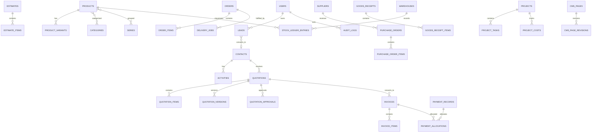

# 03 — Database Model and ERD

## 1. Purpose and status

This document defines a **logical target data model** for Laravel + MySQL. It is not a dump of the current production database and does not claim that these tables already exist. Exact column types, constraints and migrations must be designed after comparing the current Node/PostgreSQL schema, Laravel migrations and business data.

## 2. Data principles

- MySQL is the target production database.
- Laravel is the target business data authority.
- Use InnoDB and `utf8mb4`.
- Store timestamps in UTC; render in configured workspace timezone.
- Use integer minor units or fixed-precision decimals for money; never binary floating point.
- Store currency code with financial records.
- Keep immutable document snapshots for issued quotations/invoices.
- Use explicit foreign keys and indexes.
- Use soft deletion only where recovery/business retention rules allow it.
- Record actor and timestamps for important state changes.
- Never store secrets in business tables or logs.
- Avoid duplicate sources of truth for stock, invoice balance and order status.

## 3. Logical domains and entities

### Identity and authorization
- `users`
- `roles`
- `permissions`
- `role_user`
- `permission_role`
- `user_permission` (only if direct grants are required)
- `teams` / `workspace_settings` (single-business configuration, not multi-tenancy)
- `sessions` / personal access tokens depending on auth approach
- `audit_logs`

### CRM
- `leads`
- `contacts`
- `companies` (optional if B2B account relationships are needed)
- `lead_sources`
- `lead_assignments`
- `activities`
- `tasks`
- `visits`
- `notes`
- `communication_threads`
- `communication_messages`

### Sales and documents
- `estimates`
- `estimate_items`
- `quotations`
- `quotation_versions`
- `quotation_items`
- `quotation_approvals`
- `invoices`
- `invoice_items`
- `payment_records`
- `payment_allocations`
- `documents`
- `document_sequences`
- `tax_rules`
- `discount_rules` (only if pricing policy requires them)

### Commerce
- `products`
- `product_variants`
- `categories`
- `product_category`
- `series`
- `product_series`
- `product_media`
- `price_lists` / `product_prices`
- `customers` or a canonical mapping to CRM contacts
- `carts` / `cart_items` if server-side cart persistence is required
- `orders`
- `order_items`
- `order_status_history`
- `delivery_jobs`
- `installation_jobs`
- `warranty_cases`

### Procurement and inventory
- `suppliers`
- `purchase_orders`
- `purchase_order_items`
- `goods_receipts`
- `goods_receipt_items`
- `supplier_invoices`
- `warehouses`
- `stock_ledger_entries`
- `stock_reservations`
- `stock_transfers`
- `stock_transfer_items`
- `inventory_adjustments`

### Production
- `production_jobs`
- `production_job_items`
- `production_stages`
- `production_stage_events`
- `material_requirements`
- `material_consumptions`

### Projects
- `projects`
- `project_members`
- `project_tasks`
- `project_milestones`
- `project_costs`
- `vendors`
- `vendor_assignments`
- `change_requests`
- `handovers`
- `client_portal_access`

### Finance
- `accounts`
- `ledger_entries`
- `ledger_entry_lines`
- `expenses`
- `payables`
- `receipts`
- `financial_periods` (if accounting close is required)

### Website and CMS
- `cms_pages`
- `cms_page_revisions`
- `cms_templates`
- `cms_saved_sections`
- `cms_navigation_menus`
- `cms_navigation_items`
- `cms_theme_settings`
- `media_assets`
- `media_folders`
- `seo_metadata`
- `url_redirects`
- `forms`
- `form_submissions`
- `blog_posts`
- `portfolio_projects`
- `publish_events`

### Automation and integrations
- `automation_rules`
- `automation_runs`
- `automation_steps`
- `message_templates`
- `message_sequences`
- `sequence_enrollments`
- `integration_connections`
- `webhook_events`
- `outbound_messages`
- `failed_jobs`

## 4. High-level ERD

This is conceptual. The implementation ERD must include exact cardinality, nullability, unique constraints and delete behavior.

## 5. Canonical record ownership

| Business concept | Canonical owner |
|---|---|
| Product, variant, category, series and price | Commerce |
| Customer/contact | CRM identity/contact domain |
| Lead | CRM |
| Estimate and quotation | Sales |
| Invoice and payment allocation | Finance/Sales document domain |
| Order | Commerce |
| Stock movement and reservation | Inventory |
| Purchase order and receipt | Procurement |
| Production job/stages | Production |
| Project/milestone/hand-over | Projects |
| Page/Puck JSON/revision/publish state | Website |
| Media metadata and asset permissions | Media |
| User, role and permission | Identity |

A customer may appear in multiple workflows but must not be duplicated as unrelated records. Use canonical IDs and explicit mappings.

## 6. Financial data rules

- Store currency code (e.g. `PKR`) on issued financial documents.
- Use `DECIMAL(19,4)` or integer minor units according to a documented money strategy.
- Keep tax rate, tax amount, inclusive/exclusive flag and tax-rule snapshot on issued documents.
- Keep line subtotal, discount, tax and total snapshots.
- Do not recalculate historical documents from current product prices or current tax settings.
- Payments are separate records; allocate one payment to one or more invoices through `payment_allocations`.
- Do not delete posted payments; reverse or void with an audit reason.
- Financial totals are calculated server-side within transactions.

Currency PKR, configurable tax and manual payment recording are provisional carry-forward assumptions; confirm them before financial schema migrations.

## 7. Inventory rules

Use an append-only stock ledger as the source of truth for movements. A cached balance table may be used for performance but must be reconcilable to ledger entries.

Stock movement types should be explicit:
- Receipt.
- Issue/consumption.
- Transfer out/in.
- Reservation/release.
- Adjustment.
- Return.
- Dispatch (if inventory policy requires it).

Never silently overwrite a stock quantity without a corresponding ledger event and actor.

## 8. CMS versioning

`cms_pages` stores the current page identity and publication pointers. `cms_page_revisions` stores immutable serialized Puck data and metadata.

Suggested fields:
- Page: id, slug, title, page_type, status, locale, published_revision_id, created_by, updated_by, timestamps.
- Revision: id, page_id, revision_number, puck_data JSON, schema_version, change_summary, created_by, created_at.
- Publish event: page_id, revision_id, published_by, published_at, status, validation_report.

Do not overwrite the last published revision when saving a draft.

## 9. Indexing and constraints

Index:
- Foreign keys.
- Search fields used in filters.
- Document number + document type unique key.
- Slug and canonical URL.
- Status + updated timestamp for queues.
- External provider ID with provider namespace.
- Stock ledger product + warehouse + created time.
- Customer/lead normalized phone/email where matching is used.

Use unique constraints for document sequence scope, slug scope and idempotency keys.

## 10. Migration requirements

Before generating final MySQL migrations:
1. Export schema metadata from the current PostgreSQL database.
2. Inventory Laravel migrations and quarantined migrations.
3. Map every source table to a target owner.
4. Identify PostgreSQL-only types/functions/constraints.
5. Define ID strategy and foreign-key mapping.
6. Test date/time, JSON, decimal, enum and case-sensitivity behavior.
7. Rehearse full import on a clean MySQL database.
8. Compare record counts and critical financial/inventory totals.
9. Rehearse rollback and delta sync.
10. Obtain owner approval before production migration.

Do not run quarantined or imported migrations simply because files exist.
